<picture>
  <source media="(prefers-color-scheme: dark)" srcset="./assets/banner-dark.svg">
  <source media="(prefers-color-scheme: light)" srcset="./assets/banner-light.svg">
  
</picture>

<p align="center">
  
</p>

<br>

### 👋 About me

```java
public class Salih {
    String  location   = "Ankara, Türkiye";
    String  education  = "B.Sc. Computer Engineering @ Erciyes University";
    String[] interests = { "Robotics", "Autonomous Systems", "Backend" };
    String[] currently = { "Spring Boot", "React", "Docker" };
    String  goal       = "Turn ideas into clean, working software";
}
```

- 🎓 Computer Engineering student who enjoys building things end to end
- 🛠️ Recently built a **Dockerized database admin panel** with Spring Boot, React & PostgreSQL
- 🤖 Passionate about **robotics & autonomous systems** — from simulation to real-world control
- 🌱 Exploring backend architecture, clean code and the tools around it
- 🤝 Open to internships, team projects and open-source collaboration

<br>

### 🧰 Tech stack

<p align="left">
  
</p>
<p align="left">
  
  
  
</p>

<br>

### 🚀 Featured projects

<table>
  <tr>
    <td colspan="2" valign="top">
      <h4>🚙 Autonomous UGV — Teknofest İKA &nbsp;</h4>
      <p>Software for an autonomous unmanned ground vehicle built for the Teknofest İKA competition. A ROS 2 + Gazebo simulation with a custom race track (slopes, barriers, road signs), 3D LiDAR processing, PID-based autonomous driving and Nav2 navigation — plus a full URDF model of the vehicle.</p>
      <p>
        
        
        
        
        
        
      </p>
    </td>
  </tr>
  <tr>
    <td width="50%" valign="top">
      <h4>🗄️ <a href="https://github.com/salihbyrktr/dbadmin">dbadmin</a></h4>
      <p>A Dockerized database admin panel. Spring Boot REST backend, React frontend, PostgreSQL storage — everything spins up with a single <code>docker compose</code>.</p>
      <p>
        
        
        
        
      </p>
    </td>
    <td width="50%" valign="top">
      <h4>🤖 <a href="https://github.com/salihbyrktr/robot-supurge-simulasyonu">robot-supurge-simulasyonu</a></h4>
      <p>A JavaFX simulation of an autonomous robot vacuum: obstacle avoidance, three cleaning algorithms, battery management and BFS pathfinding back to the charging station.</p>
      <p><sub>🎓 Team course project · BZ 214 Visual Programming · Erciyes University</sub></p>
      <p>
        
        
        
      </p>
    </td>
  </tr>
</table>

<br>

### 🐍 Contribution activity

<picture>
  <source media="(prefers-color-scheme: dark)" srcset="https://raw.githubusercontent.com/salihbyrktr/salihbyrktr/output/github-snake-dark.svg">
  <source media="(prefers-color-scheme: light)" srcset="https://raw.githubusercontent.com/salihbyrktr/salihbyrktr/output/github-snake.svg">
  
</picture>

<br>

### 📫 Connect

<p align="left">
  <a href="https://github.com/salihbyrktr"></a>
  <!-- LinkedIn hesabın varsa aşağıdaki satırın başındaki/sonundaki yorum işaretlerini kaldır ve linki düzelt -->
  <!-- <a href="https://www.linkedin.com/in/KULLANICI-ADIN"></a> -->
</p>
